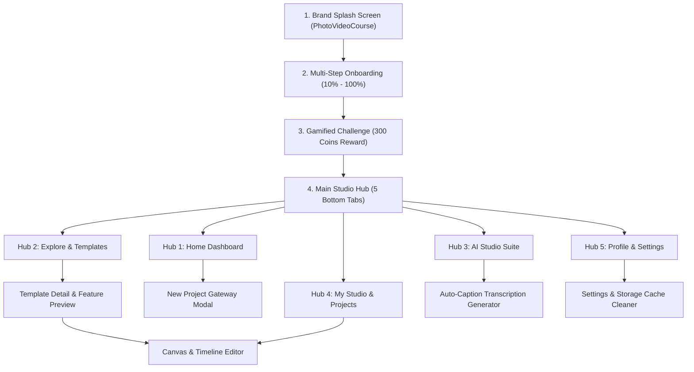

# CapCut Video Editor (PhotoVideoCourse) — Replica

A pixel-perfect, fully functional mobile application replica of **CapCut Video Editor** (`com.rvariety.capcut`), engineered in **Flutter (Dart)** using **Riverpod** for reactive state management, **GoRouter** for declarative nested navigation, and modern dark design tokens extracted directly from the decompiled APK assets and live ARTEMIS screen audit.

---

## 📱 Architectural Overview

* **Framework**: Flutter 3.x (Dart 3.x SPA architecture matching the original APK)
* **State Management**: Flutter Riverpod (`StateNotifierProvider`, `ProviderScope`) with strict separation of presentation and business logic.
* **Routing**: GoRouter declarative nested routing with deep-linkable URLs.
* **Styling**: Obsidian/Midnight Canvas dark theme (`#080810`, `#090911`, `#161622`), CapCut vibrant pink/coral accents (`#FF2A6D`), Cyber Cyan (`#00E5FF`), and Golden Amber (`#FFB800`).
* **Package Name**: `com.rvariety.capcut`
* **App Display Name**: `PhotoVideoCourse`

---

## 🗺️ Complete Navigation Flow



---

## 🔬 Reverse-Engineered Functional Domains

### Domain 1: Onboarding & User Profile Setup (Screens 01 – 18)
* **Screen 01**: Brand Splash with "PhotoVideoCourse", "Create. Edit. Inspire.", neon glowing icon, and auto-progression.
* **Screen 02 & 03**: User Name registration ("Your Name", "What should we call you?", hint "Enter your name", reactive Continue button).
* **Screen 07**: Date of Birth calendar picker modal.
* **Screen 09**: Country localization selector with flags (India, US, UK, Canada, Australia, Germany, France, Japan).
* **Screen 11**: Gender selection (Male, Female, Non-Binary, Prefer Not To Say).
* **Screen 13**: Multi-select interests grid (Travel, Gaming, Business, Sports, Music, Food, etc.).
* **Screen 15**: Editing experience level (Beginner, Intermediate, Advanced, Professional).
* **Screen 16**: Favorite content categories (Reels, Shorts, TikTok, YouTube).
* **Screen 17**: AI preferences checklist (Auto Caption, Background Remove, AI Voice, Video Upscaler).
* **Screen 18**: Dynamic initial avatar badge generation (`M` for `megh`).

### Domain 2: Main Studio Dashboard (Screens 19, 20, 37)
* **Header**: Personalized greeting `"Hey, megh 👋"`, subtitle `"What will you create today?"`, and circular filter settings icon button.
* **Hero Project Card**: Vibrant coral-pink gradient card with `"NEW PROJECT"` badge, `"Start Creating"`, `"Video, photo & more"`, and circular `+` button.
* **Metrics Row**: 3 key performance counters: `0 Projects` (pink), `6 Templates` (cyan), and `4K Export` (amber).
* **Quick Tools**: Horizontal stadium pills:
  * `⚡ AI Magic` (Emerald green tint)
  * `⊞ Templates` (Ruby pink tint)
  * `⛶ Blank` (Golden amber tint)
  * `🎬 Studio` (Deep purple tint)
* **Recent Work**: Project card with `"Sample Photo"`, thumbnail, and direct link to timeline editor.
* **Trending Now**: Dual-column cards with `"HOT"` badges, play counts, and durations.

### Domain 3: AI Video Lab & Auto-Caption Engine (Screens 22, 23)
* **AI Studio Hub**: `AI STUDIO` pill badge, `"AI Magic"` header, and 8 dedicated AI tools:
  1. `Auto Caption` (subtitles generator)
  2. `AI Voice` (text-to-speech)
  3. `Background Remove` (smart cutout)
  4. `Object Remove` (object removal)
  5. `AI Enhance` (quality upscale)
  6. `Video Upscaler` (HD resolution)
  7. `Script Gen` (AI writing)
  8. `AI Translation` (multilingual audio)
* **Auto-Caption Generator**:
  * Live video preview with interactive subtitle overlay.
  * Source language dropdown (English, Bilingual EN+HI, Spanish, Hindi, French, German).
  * Audio track picker (Original Audio vs Voiceover).
  * Subtitle template style carousel (Neon Pop, Cyber Cyan, Classic White, Golden Box, Karaoke Pop).
  * Real-time multi-stage AI transcription simulation with progress bar (0% to 100%) and phoneme alignment.
  * Export/Apply synchronized subtitles directly to timeline editor.

### Domain 4: Templates & Social Discovery Feed (Screens 25, 26, 28, 34)
* **Explore Feed**: Staggered dual-column video cards with view counts (`31K`, `45K`, `52K`, `67K`).
* **Category Filters**: Horizontal scrollable chips (`All`, `Trending`, `Travel`, `Gaming`, `Business`).
* **Template Detail View (Screen 28)**:
  * Full-width 9:16 portrait video player with play/pause and audio track waveform.
  * Metadata pills: `Travel`, `15s`, `12.5K uses`, `9:16`.
  * Included features checklist: *Cinematic Transitions, Map Overlay, Travel Music, Text Titles*.
  * Floating `"Use Template & Edit"` action button that copies the template into a new editable project.

### Domain 5: Canvas Editor & Timeline Studio (Screen 32)
* **Top Toolbar**: Back button, project title, Undo, Redo, and bright pink `"Export"` button.
* **Viewport**: 9:16 portrait video preview with real-time color filter shaders and text overlays.
* **Scrubber Track**: Interactive draggable playhead scrubber with search zoom icon and timecode indicator (`00:00 / 00:15`).
* **Bottom Tool Dock**: Horizontal scrollable rail:
  * `Split`: Interactive split options (Option 1 through 5).
  * `Crop`: Aspect ratio presets (9:16, 16:9, 1:1, 4:5).
  * `Filter`: Real-time color matrix filters (Normal, Cinematic, Vintage, B&W, Cyberpunk, Glow).
  * `Text`: Custom subtitle/title overlay editor.
  * `Audio`: Volume slider (0-100%).
  * `Speed`: Playback speed multipliers (0.5x, 1.0x, 1.5x, 2.0x).
* **Export Dialog**:
  * Resolution selector (720p HD, 1080p Full HD, 2K/4K Ultra HD).
  * Frame rate selector (30 FPS vs 60 FPS).
  * Live rendering progress indicator with MB estimation and Share sheet integration.

### Domain 6: Account, Profile & Application Settings (Screens 35, 36)
* **Profile ("Me")**:
  * Top pink hero card with initial circle avatar (`M`), user display name (`megh`), and country (`India`).
  * 3 Stats cards: `Projects (1)`, `Exports (0)`, `Storage (0 MB)`.
  * Navigation menu: Settings, History, Feedback, Help & Support, About.
* **Settings**:
  * `GENERAL`: Language selector modal (EN, ES, HI, FR, DE, JA, etc.), Default Frame Rate (30/60 FPS).
  * `STORAGE`: Cache cleaner with confirmation dialog (simulates deleting 284 MB of temporary preview files).
  * `LEGAL`: Privacy Policy, Terms of Service, Open Source Licenses.
  * `SUPPORT`: Rate App (Play Store), Send Feedback, Version info (1.0.0).

---

## 📂 Project Directory Structure

```
capcut2/
├── pubspec.yaml                  # Flutter package definition and assets
├── analysis_options.yaml          # Strict Dart lint rules
├── android/                      # Native Android project configuration
│   ├── app/
│   │   ├── build.gradle
│   │   └── src/main/
│   │       ├── AndroidManifest.xml
│   │       └── kotlin/com/rvariety/capcut/MainActivity.kt
│   ├── build.gradle
│   ├── settings.gradle
│   └── local.properties
├── assets/
│   ├── images/                   # App icon, logo, and high-res sample textures
│   │   ├── logo.jpg
│   │   ├── app_icon.png
│   │   ├── sample_lake.jpg
│   │   ├── sample_coffee.jpg
│   │   ├── sample_forest.jpg
│   │   └── sample_wheel.jpg
│   └── translations/             # Localization JSON bundles
│       ├── en.json
│       └── es.json
└── lib/
    ├── main.dart                 # Application entry point & System UI overlay
    ├── core/
    │   ├── theme/
    │   │   ├── app_colors.dart    # Obsidian dark palette & vibrant accents
    │   │   ├── app_typography.dart
    │   │   └── app_theme.dart     # ThemeData configuration
    │   ├── routing/
    │   │   ├── app_router.dart    # GoRouter declarative navigation graph
    │   │   └── route_names.dart
    │   └── constants/
    │       ├── app_strings.dart
    │       └── app_constants.dart
    ├── models/
    │   ├── user_profile.dart      # User state & avatar calculation
    │   ├── template_model.dart    # Explore video templates
    │   ├── project_model.dart     # Drafts & canvas metadata
    │   ├── ai_tool_model.dart     # AI Studio tools
    │   └── quiz_question_model.dart # Onboarding trivia reward
    ├── providers/
    │   ├── user_provider.dart
    │   ├── project_provider.dart
    │   ├── template_provider.dart
    │   ├── ai_studio_provider.dart
    │   └── settings_provider.dart
    ├── screens/
    │   ├── splash/
    │   │   └── splash_screen.dart
    │   ├── onboarding/
    │   │   └── onboarding_wrapper_screen.dart
    │   ├── quiz/
    │   │   └── quiz_reward_screen.dart
    │   ├── shell/
    │   │   └── main_shell_screen.dart # 5-tab bottom navigation shell
    │   ├── home/
    │   │   └── home_dashboard_screen.dart
    │   ├── explore/
    │   │   ├── explore_feed_screen.dart
    │   │   └── template_detail_screen.dart
    │   ├── ai_studio/
    │   │   ├── ai_studio_hub_screen.dart
    │   │   └── auto_caption_screen.dart
    │   ├── studio/
    │   │   ├── my_studio_screen.dart
    │   │   └── widgets/
    │   │       └── new_project_modal.dart
    │   ├── editor/
    │   │   └── timeline_editor_screen.dart
    │   └── profile/
    │       ├── profile_screen.dart
    │       └── settings_screen.dart
    └── widgets/
        ├── gradient_badge.dart
        ├── rounded_pill.dart
        └── glowing_action_button.dart
```

---

## 🚀 How to Run and Verify the Replica

### Prerequisites
1. **Flutter SDK** installed and configured in your environment (`flutter doctor`).
2. An Android device or emulator connected with USB debugging enabled.
   Verify with ADB:
   ```bash
   adb devices -l
   ```
   *(e.g., Target Device: Motorola Edge 20 Fusion `ZD22249LP3`)*

### Setup & Execution Commands
1. Navigate to the project directory:
   ```bash
   cd c:\Users\intel\Downloads\capcut2
   ```

2. Fetch all Flutter dependencies:
   ```bash
   flutter pub get
   ```

3. Run the application directly on your connected device:
   ```bash
   flutter run -d ZD22249LP3
   ```
   *(Or omit `-d` to run on the default connected device/emulator)*

4. Build a debug APK:
   ```bash
   flutter build apk --debug
   ```

5. Install and launch the generated APK on the device:
   ```bash
   adb -s ZD22249LP3 install -r build/app/outputs/flutter-apk/app-debug.apk
   adb -s ZD22249LP3 shell monkey -p com.rvariety.capcut -c android.intent.category.LAUNCHER 1
   ```
